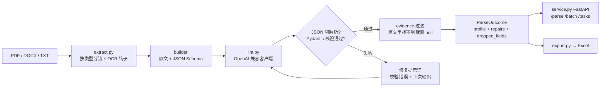

# resume-parser-agent

[](https://github.com/QinHuai00/resume-parser-agent/actions/workflows/ci.yml)


把 PDF / Word / TXT 简历解析成结构化 JSON 的抽取 Agent：
**Pydantic 契约约束输出 → 校验失败回灌修复 → 字段级证据溯源 → 批量并发 → 评测集回归**。

> 一句话：它不是「调一次大模型拿个 JSON」，而是一条**能定位失败原因、能防编造、能被评测**的抽取流水线。

## 它解决什么问题

批量简历筛选时，真正难受的不是「模型抽不出来」，而是：

| 问题 | 表现 | 本项目的解法 |
| --- | --- | --- |
| 输出结构不稳定 | 今天 `years: 3`，明天 `years: "3 年"`，后天多吐两个字段，入库直接崩 | Pydantic 模型 + `extra="forbid"` + JSON Schema 写进提示词 |
| 一次失败整条重跑 | 校验挂了就重新调用，token 与延迟双倍烧 | 把 `ValidationError` 原文回灌，**只修错的那几个字段** |
| 编造字段 | 原文没写手机号，模型给你编一个，入库后再也查不出来 | `evidence` 逐字段要求原文片段，原文找不到就置 `null` |
| 单份能跑、批量就崩 | 100 份里 1 份报错拖死整批 | 批量任务后台执行 + 信号量限并发 + 单份失败隔离 |
| 效果说不清 | 只会说「挺准的」 | 内置评测脚本：结构合法率、修复轮次、字段准确率、技能 F1 |

## 架构



### 四段式流水线

```
解析  extract.py      按后缀分流：docx 走 python-docx（含表格），pdf 走 pypdf，抽不出字走 OCR 钩子
抽取  pipeline.py     原文 + JSON Schema 一起给模型，要求「只能从原文抽，缺就 null」
校验  schema.py       Pydantic：邮箱格式、手机号位数、年限区间、禁止多余字段
修复  pipeline.py     把 ValidationError 原文回灌，只修错的字段，默认 1 轮
溯源  pipeline.py     evidence 必须是原文逐字片段，对不上的字段直接置 null
```

## 实测结果（离线可复现）

模拟模型注入 35% 脏输出，12 份合成简历：

| 指标 | 无修复 | 有修复（1 轮） |
| --- | --- | --- |
| 结构合法率 | 91.7% | **100%** |
| 平均修复轮次 | 0 | 0.08 |
| 技能集合 F1 | 0.917 | **1.000** |
| phone 准确率 | 66.7% | 75.0% |

100% 脏输入下：结构合法率仍是 **100%**，触发修复比例 50%、平均轮次 0.5。

> 完整表格、以及「为什么 phone 只有 75% 不是 bug」的解释见 [`eval/results.md`](eval/results.md)。
> `mock` 模式只证明修复环与证据过滤有效，不冒充模型能力；真实模型数字需配 key 用 `--provider openai` 自己跑。

## 快速开始

```bash
pip install -e ".[dev]"

# 1) 离线测试（36 个用例，不联网、不花钱）
pytest -q

# 2) 生成评测集 + 跑评测
python eval/make_dataset.py
python -m resume_agent.cli eval --provider mock --corrupt-rate 0.35 --max-repairs 1

# 3) 起服务
export LLM_BASE_URL=https://dashscope.aliyuncs.com/compatible-mode/v1
export LLM_API_KEY=sk-xxxx
export LLM_MODEL=qwen-plus
python -m resume_agent.cli serve --port 8000
```

`LLM_BASE_URL` 只要兼容 OpenAI 的 `/chat/completions` 就行（DashScope、DeepSeek、vLLM、Ollama 均可），
换厂商只改这一个环境变量。

### 接口示例

```bash
# 单份（同步，1~3 秒）
curl -X POST http://127.0.0.1:8000/api/v1/parse -F "file=@cv.pdf"

# 批量（立刻返回 task_id，后台跑）
curl -X POST http://127.0.0.1:8000/api/v1/batch -F "files=@a.docx" -F "files=@b.pdf"
curl http://127.0.0.1:8000/api/v1/tasks/<task_id>
```

```json
{
  "source": "cv.pdf",
  "valid": true,
  "profile": {
    "name": "张伟",
    "phone": "13812345678",
    "email": "zhangwei01@example.com",
    "city": "深圳",
    "years_of_experience": 3.0,
    "education": [{"school": "华南理工大学", "major": "软件工程", "degree": "本科"}],
    "skills": ["Python", "FastAPI", "MySQL"]
  },
  "repairs": 1,
  "dropped_fields": ["experiences.0.company"],
  "error": null
}
```

`dropped_fields` 是被证据过滤判定为「编造」而清空的字段——这是这套系统最该被观察的输出，
不是副产品。

## 目录结构

```
src/resume_agent/
  schema.py     Pydantic 数据模型 + JSON Schema 生成（契约层）
  llm.py        模型接入：真实 API / 脚本回放 / 注入故障的模拟模型
  extract.py    文档解析，按类型分流 + OCR 钩子
  pipeline.py   解析→抽取→校验→修复→证据过滤（核心）
  service.py    FastAPI：单份同步 / 批量异步 + 任务查询
  export.py     结构化结果导出 Excel
  evaluate.py   评测指标：结构合法率 / 修复轮次 / 字段准确率 / 技能 F1
  cli.py        命令行入口
eval/
  make_dataset.py  生成 12 份合成简历 + 逐字段 gold 与 evidence
  dataset.jsonl    评测集
  results.md       实测结果与解读
tests/             36 个用例，全部离线
```

## 关键取舍（面试会被追问的部分）

1. **为什么不用 function calling 强约束输出？**
   跨厂商兼容性差、工具 schema 表达力弱于完整 JSON Schema；而「JSON Schema + 校验回灌」
   能把*具体哪一行错了*写进提示词，迁移成本也更低。代价是模型可能不遵守 schema，所以才需要校验环。
2. **为什么修复只做 1 轮？**
   第 1 轮能救回全部「可修复」故障（结构合法率 91.7% → 100%），第 2 轮收益边际递减而延迟线性增长。
   参数留着，按业务容忍度调。
3. **为什么证据过滤宁可丢字段？**
   抽取结果要入库做筛选，一条假手机号会污染下游全部决策；空值至少是「未知」。
   代价是召回下降（phone 75%），这个代价是显式的、可观测的（`dropped_fields`）。
4. **为什么批量接口要异步？**
   单份 1~3 秒，100 份同步处理会把 worker 占满十几分钟；先返回 `task_id`、后台协程跑、
   客户端轮询，是服务端处理长任务的基本模式。
5. **为什么不用 LangChain / 编排框架？**
   这条流水线的控制流（校验、回灌、丢弃）需要精确可见；框架把重试与解析藏在内部，
   排查「为什么这条被丢了」反而更难。依赖越少越好调试。

## 已知局限

- **OCR 只是钩子**：扫描件要自己接 PaddleOCR / 云 OCR，仓库默认不装重依赖。
- **未做多模型投票**：单模型单次 + 1 轮修复；高价值场景可加「双模型交叉校验」。
- **任务状态在内存**：进程重启丢任务，生产要落 Redis；
- **没有鉴权与限流**：内网工具定位，暴露公网需自行加网关。
- **评测集是合成的**：12 份、字段有限；真实简历的排版噪声远大于合成数据，指标只能当回归基线。

## License

MIT

---

作者：[QinHuai00](https://github.com/QinHuai00)